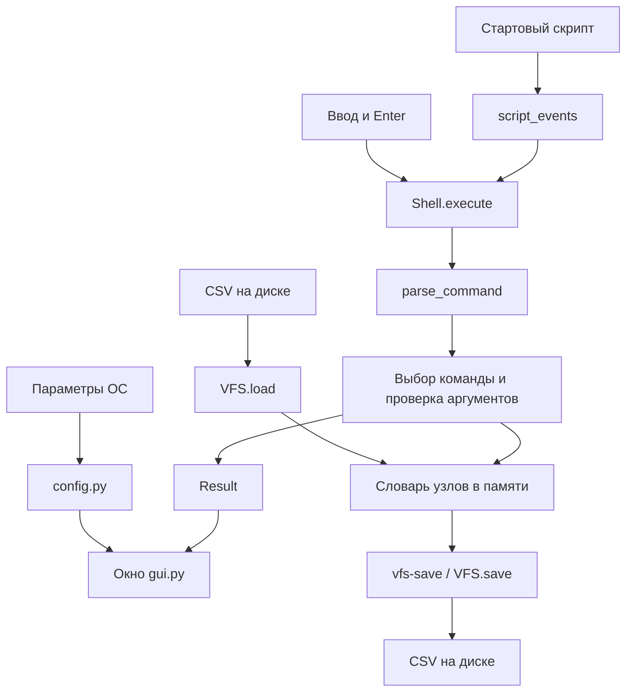

# Руководство для защиты эмулятора оболочки

## 1. Что представляет собой проект

Программа имитирует небольшой набор команд UNIX-подобной оболочки.
Пользователь вводит команды в графическом окне. Программа разбирает строку,
проверяет аргументы и выполняет действие над виртуальной файловой системой.
VFS загружается из CSV в оперативную память. Файлы на настоящем диске
при выполнении `ls`, `cd`, `rev` и `mv` не изменяются.

Можно начать защиту так:

> Это эмулятор командной оболочки с графическим интерфейсом на Tkinter.
> Виртуальная файловая система загружается из CSV, а содержимое файлов
> хранится в base64. После загрузки операции выполняются в памяти.
> Есть стартовый скрипт, обработка ошибок и явное сохранение VFS в CSV.
> Ввод делится на команду и аргументы по пробельным символам.

**Оболочка** — программа, принимающая команды пользователя и организующая
их исполнение. **Эмулятор** воспроизводит выбранное поведение другой системы.
Этот проект реализует команды самостоятельно: настоящие `ls` или `mv`
из ОС он не запускает.

**REPL** означает Read → Eval → Print → Loop: прочитать ввод, выполнить,
показать результат и ждать следующую команду. В GUI этот цикл организован
через обработчик Enter и цикл обработки событий Tkinter.

## 2. Как запустить перед преподавателем

Открой терминал в корне репозитория:

```sh
cd shell_emulator
python3 main.py
```

Для автоматической демонстрации:

```sh
sh scripts/demo.sh
```

Скрипт реальной ОС создаёт папку `output` и запускает программу с двумя
параметрами. Затем уже внутри GUI выполняются команды из `all.txt`.
Это **два разных вида скриптов**:

- `.sh` исполняется настоящей оболочкой macOS/Linux, запускает Python;
- `.txt` читает наш эмулятор, выполняет свои команды над VFS.

Проверка окружения: `python3 -m tkinter` должна открыть небольшое окно Tk.
Установка Tkinter описана в README. Для проекта нужен Python 3.10+,
сторонние пакеты через pip устанавливать не требуется.

## 3. Карта файлов: что читать и в каком порядке

| Файл | Что находится внутри |
|---|---|
| `main.py` | Получение параметров и запуск окна. |
| `config.py` | Описание аргументов `--vfs` и `--script` через argparse. |
| `shell.py` | Простой парсер, состояние оболочки и команды. |
| `vfs.py` | Модель файлов, загрузка/сохранение CSV, пути, чтение и перемещение. |
| `startup.py` | Чтение строк стартового скрипта и передача их в Shell. |
| `gui.py` | Виджеты Tkinter, обработка Enter, вывод и выполнение скрипта по таймеру. |

Для первого знакомства читай в таком порядке: `main.py` → `config.py` →
`Shell.execute` → `VFS.__init__` → `VFS.resolve` → `VFS.move` → `gui.py` →
`startup.py`. Не обязательно сразу запоминать весь код загрузчика CSV.
Сначала разберись, как одна команда проходит через программу.



## 4. Разбор одного действия от начала до конца

Допустим, введено `cd /home/student/docs`.

1. Нажатие Enter вызывает `Terminal.submit` — привязка задана через `bind`.
2. `entry.get()` получает строку, `entry.delete()` очищает поле ввода.
3. `write()` добавляет в историю приглашение и введённый текст.
4. `Shell.execute(line)` вызывает `parse_command`.
5. Парсер получает `command = "cd"`, `args = ["/home/student/docs"]`.
6. Ветка `cd` проверяет, что аргументов не больше одного.
7. `VFS.resolve` проверяет путь по компонентам и возвращает абсолютный путь.
8. Проверяется, что найденный узел имеет тип `dir`.
9. Обновляется `self.cwd`; возвращается пустой `Result()`.
10. `Terminal.apply` обновляет приглашение на `student@vfs:/home/student/docs$`.

Если путь не найден, возникает ожидаемое исключение `VFSError`.
`Shell.execute` перехватывает его и возвращает `Result(error=True, output=...)`.
GUI просто печатает сообщение. Программа продолжает работать.

Ключевая идея: **GUI не реализует команды, а команды не управляют виджетами**.
Поэтому логика команд не зависит от состояния виджетов окна.

## 5. Основные конструкции Python, которые нужно понимать

### Классы и состояние

`class Shell` описывает оболочку. `self` — текущий экземпляр класса.
У него есть `self.cwd` (текущий виртуальный каталог) и `self.vfs` (дерево VFS).
Два разных экземпляра `Shell` могут иметь независимые состояния.

`class VFS` хранит `self.nodes`, то есть словарь узлов. Словарь — отображение
ключа на значение; здесь ключом служит строка пути, значением — объект `Node`.

### dataclass

`@dataclass` автоматически создаёт конструктор и сравнение объектов по полям.
`Node(kind="file", data=b"Hello")` описывает один узел.
`frozen=True` запрещает менять поля готового Node; при перемещении меняется
ключ в словаре, байты файла остаются теми же.

`Result` — результат исполнения команды: текст и три признака `clear`,
`exit`, `error`. Все признаки по умолчанию `False`. Например,
`Result(clear=True)` сообщает окну, что нужно очистить историю.

### Строки и байты

`str` — текст Unicode, `bytes` — последовательность байтов.
`"Привет".encode("utf-8")` превращает текст в байты;
`data.decode("utf-8")` превращает байты в текст, если это допустимый UTF-8.
VFS хранит **байты**, поэтому может сохранять и двоичные файлы.
Только текстовая команда `rev` декодирует их как UTF-8.

### Исключения

`raise VFSError(...)` прерывает текущую операцию и передаёт ошибку обработчику.
`try/except` позволяет показать понятное сообщение и продолжить диалог.
Перехватываются ожидаемые ошибки, а не произвольный `Exception`: ошибка
самой программы не должна незаметно превращаться в обычную ошибку команды.

### with и pathlib

`with path.open(...) as stream` гарантирует закрытие файла даже при ошибке.
`Path` из `pathlib` нужен для физических файлов ОС: CSV и стартового скрипта.
Для виртуальных путей используется `posixpath`, чтобы `/` и правила путей
оставались UNIX-подобными даже при запуске на Windows.

### Генератор

`script_events` использует `yield`. Он выдаёт один результат, затем
приостанавливается до следующего `next()`. Это позволяет GUI выполнять
команды скрипта постепенно через `root.after`, не блокируя окно большим циклом.

### Срезы и включения словарей

`body[::-1]` — строка в обратном порядке.
`path[len(source):]` — часть пути после старого префикса.
Словарное включение `{key: value for ... if ...}` строит новый словарь,
выбирая и преобразуя нужные элементы. Такие включения используются в `move`.

## 6. Парсер и ограничения командной строки

`parse_command` делает `line.split()`. Без аргумента `split` разделяет
строку по пробельным символам: пробелам, табуляциям и их повторениям.
Пустая строка даёт `("", [])`. Первый элемент — имя команды, остальные — аргументы.

Например:

```text
  ls   -a   /home
```

становится `("ls", ["-a", "/home"])`.

Кавычки здесь не имеют специального значения:
`echo "hello world"` напечатает текст вместе с кавычками.
Файл с пробелом в имени этим парсером адресовать нельзя.
Перенаправления `>`, конвейеры `|`, подстановки и переменные не поддерживаются.
Это соответствует требованию простого парсера и границам проекта.

Различай ошибки: **неизвестная команда** — нет такой ветки обработчика;
**неверные аргументы** — команда известна, но не выполнены её правила вызова;
**ошибка операции** — аргументы разобраны, но, например, файл не найден.

## 7. Как устроена VFS

В памяти дерево представлено словарём:

```python
{
    "/": Node("dir"),
    "/home": Node("dir"),
    "/home/hello.txt": Node("file", b"Hello\n"),
}
```

Вложенность задаёт полный путь. Отдельные списки детей в каталогах не нужны:
при `ls` выбираются узлы, у которых `posixpath.dirname(path)` равен нужному
каталогу. Словарь проще рекурсивного дерева для размера этой работы.

Условия корректного дерева:

- корень `/` существует и является каталогом;
- все пути абсолютные и нормализованные;
- один путь не повторяется;
- родитель каждого узла существует и является каталогом;
- тип узла только `dir` или `file`;
- у каталогов нет содержимого.

`/home/student/docs/readme.txt` демонстрирует три уровня каталогов
`home` → `student` → `docs` и файл внутри них.

### CSV и base64

CSV — таблица строк с разделением полей запятыми. Используется стандартный
модуль `csv`, который правильно обрабатывает кавычки и разделители.
Заголовок должен быть ровно `path,type,content`, в этом порядке.

Обычный текст и двоичные данные файлов сохраняются в base64. Это кодирование
байтов в ограниченный набор печатных символов. Оно не шифрует и не сжимает
данные. Пример: `b"Hello\n"` → `SGVsbG8K`.
Приблизительный размер base64 на треть больше исходных данных.

При загрузке `base64.b64decode(..., validate=True)` проверяет формат
и получает исходные байты. При сохранении `b64encode` выполняет обратное
преобразование, затем `.decode("ascii")` получает текст для поля CSV.

### Почему загрузка сделана в два прохода

Сначала загрузчик читает строки и создаёт узлы, проверяя формат, типы,
повторы путей и base64. Затем проверяет родительские каталоги.
Так строки могут идти в любом порядке: файл допустимо записать раньше
его родительского каталога.

Ошибка CSV, UTF-8, отсутствующий физический файл или неверное дерево
превращаются в `VFSError`. GUI выводит сообщение и отключает ввод:
работать с незагруженной VFS нельзя.

## 8. Как обрабатываются пути

`cwd` — Current Working Directory, текущий рабочий каталог.
Абсолютный путь начинается с `/`, относительный — от `cwd`.

| При cwd `/home/student` | Результат |
|---|---|
| `docs` | `/home/student/docs` |
| `./docs` | `/home/student/docs` |
| `../student/docs` | `/home/student/docs` |
| `/tmp` | `/tmp` |
| `../../../../` | `/` |

`VFS.resolve` идёт слева направо. Для каждого компонента проверяется,
что предыдущий узел — существующий каталог. `.` оставляет текущий путь,
`..` берёт родителя; родитель корня остаётся корнем.

Почему недостаточно просто вызвать `normpath`? Путь `/hello.txt/..`
математически упрощается до `/`, но в файловой системе идти через файл
как через каталог нельзя. Наш алгоритм обнаруживает такую ошибку.
Аналогично `/missing/../home` не должен скрывать отсутствие `missing`.

Для назначения `mv` используется `allow_missing=True`: последний компонент
может ещё не существовать, но его родитель обязан существовать.
Завершающий `/` требует, чтобы назначение уже было каталогом.

## 9. Разбор каждой команды

### ls

Проверяет, что есть не больше одного пути и поддерживаемая опция `-a`.
Без пути берёт текущий каталог. Для каталога выбирает непосредственных детей,
сортирует имена и добавляет `/` к именам каталогов. Без `-a` скрытые имена,
начинающиеся с точки, пропускаются. С `-a` дополнительно выводятся `.` и `..`.
Для файла выводится его имя. Пустой каталог не даёт строк вывода.

### cd

Принимает ноль или один путь. Без аргумента выбирает `/`.
Сначала полностью проверяет путь и тип узла, затем меняет `cwd`.
При ошибке старый каталог остаётся прежним. Настоящий `os.chdir` здесь
не вызывается: текущий каталог реальной ОС менять не нужно.

### rev

Принимает один или несколько путей к текстовым файлам VFS.
Для каждого файла получает текст UTF-8, разбивает его на строки с сохранением
окончаний, разворачивает тело строки срезом `[::-1]` и возвращает окончание.
Порядок строк не меняется. Файл не изменяется.

```text
Hello
UNIX
```

превращается в:

```text
olleH
XINU
```

Двоичный файл с недопустимым UTF-8 вызывает понятную ошибку. Чтение из stdin
в этом GUI не реализовано. Если хотя бы один файл ошибочный, результат
всего вызова — сообщение об ошибке, без частичного вывода.

### echo

Соединяет аргументы одним пробелом и обычно добавляет `\n`.
Если первый аргумент `-n`, завершающего перевода строки нет.
`echo` без текста выводит пустую строку. Повторяющиеся пробелы исходного ввода
уже потеряны на этапе `split`.

### clear

Не принимает аргументов. Возвращает `Result(clear=True)`.
Само удаление текста делает GUI. VFS и `cwd` остаются прежними.
В сценарии `stage4.txt` команда намеренно удаляет предыдущую видимую историю.

### mv

Принимает ровно два аргумента: источник и назначение.
`VFS.move` выполняет следующие действия:

1. Приводит оба пути к абсолютным, проверяет их существование.
2. Запрещает перенос корня.
3. Если назначение — каталог, добавляет к нему имя источника.
4. Запрещает одинаковые пути и перенос внутрь своего поддерева.
5. Проверяет конфликт типов и непустой каталог назначения.
6. Строит словарь перемещаемых узлов с новыми путями.
7. Строит словарь оставшихся узлов и добавляет перемещённые.
8. Заменяет `self.nodes` только после завершения проверок.

Пример замены префикса:

```text
источник: /home/student
назначение после вычисления: /archive/student
старый путь: /home/student/docs/readme.txt
суффикс: /docs/readme.txt
новый путь: /archive/student/docs/readme.txt
```

Проверка поддерева использует `source + "/"`, чтобы `/home/a` не захватил
несвязанный путь `/home/abc`.

Если переместили текущий каталог или его предка, `Shell.execute`
тем же способом обновляет `cwd`. Байты файлов не копируются на диск.
Ошибочная команда не должна частично менять дерево.

Режимы: переименование файла, перенос в каталог, переименование каталога,
перенос каталога с потомками, замена файла файлом и пустого каталога каталогом.
Опции `-i`, `-f`, `-n` и несколько источников не реализованы.

### vfs-save

Принимает ровно один **физический путь ОС**, открывает его на запись
и сериализует весь словарь в CSV с тем же заголовком и base64.
Пути записываются в отсортированном порядке для воспроизводимости.
Текстовое расположение строк может отличаться от исходника, но дерево
и байты файлов после повторной загрузки совпадают.

Это разрешённая служебная команда, которая явно пишет на диск.
Другие команды VFS не распаковывают и не меняют исходный CSV.
Существующий файл назначения перезаписывается, поэтому в демонстрации
используется отдельный путь `output/state.csv`.

### exit

Не принимает аргументов. Возвращает `Result(exit=True)`.
GUI вызывает `root.destroy()`, закрывая окно и прекращая цикл событий.
Сохранение автоматически не выполняется: перед выходом нужно вызвать
`vfs-save`, если изменения нужны.

## 10. Как устроены GUI и стартовый скрипт

В окне два основных элемента: `ScrolledText` для истории и `Entry` для ввода.
История обычно имеет `state=DISABLED`, чтобы пользователь её не редактировал.
`write` временно включает редактирование, добавляет текст, прокручивает
к концу и снова блокирует виджет.

`root.mainloop()` обрабатывает события окна: нажатия клавиш, обновления,
таймеры. `bind("<Return>", self.submit)` связывает Enter с обработчиком.
`root.after(40, self.script_step)` планирует следующий шаг скрипта.
Эти 40 мс нужны для последовательного отображения и обработки событий,
а не для работы логики файловой системы.

Во время стартового скрипта поле ввода отключено, чтобы ручная команда
не вмешалась между его строками. После завершения поле включается.
Команды и их результаты показываются так же, как при ручном вводе.
Приглашение сохраняется **до исполнения** команды, поэтому строка `cd`
показывает старый путь, а следующая — новый.

Скрипт читается как UTF-8 с допустимым BOM. Пустые строки пропускаются.
Для ошибки команды выводятся путь скрипта и номер исходной строки.
Затем генератор выдаёт следующую команду. `exit` — особое успешное действие:
оно останавливает скрипт и приложение, строки после него не исполняются.
Комментарии `#` отдельно не разбираются: такие строки считаются командами.

## 11. Сценарий ручной демонстрации на 5–7 минут

Начни с нового запуска `python3 main.py`, чтобы VFS была в исходном состоянии.
Покажи имя `demo.csv` в заголовке и параметры в начале истории.
Затем вводи команды по одной и объясняй результат:

```text
ls
ls -a
cd /home/student/docs
ls
rev readme.txt
cd ..
echo Привет преподавателю
echo -n Без перевода строки
rev notes.txt
mv notes.txt todo.txt
ls
mv /home/student /archive
ls
rev todo.txt
```

После перемещения текущий путь будет `/archive/student`, а `todo.txt`
сохранит содержимое. Затем покажи ошибки:

```text
unknown
cd a b
cd /hello.txt
rev /binary.bin
mv /archive /archive/student/docs
exit extra
```

Ожидается: неизвестная команда, лишние аргументы, попытка перейти в файл,
неверный UTF-8, запрет цикла, неверные аргументы выхода. После каждой ошибки
окно работает и состояние остаётся корректным.

В реальном терминале заранее создай `output`: `mkdir -p output`.
В GUI выполни:

```text
vfs-save output/defense.csv
clear
ls -a /
exit
```

После сохранения можно запустить `python3 main.py --vfs output/defense.csv`
и показать сохранённое перемещение. Для проверки исходного CSV снова
запусти с `examples/vfs/demo.csv`: в нём всё осталось как было.

Отдельно покажи `sh scripts/test_errors.sh` и `sh scripts/test_vfs.sh`:
они демонстрируют ошибки загрузки и три разных наполнения VFS.
Стартовый скрипт можно показать через `sh scripts/demo.sh`.

## 12. Как проверить работу вручную

Запусти `sh scripts/demo.sh` в терминале ОС и просмотри результаты.
Ошибочные команды включены специально: после них выполнение должно продолжаться.
Скрипты `test_config.sh`, `test_vfs.sh`, `test_errors.sh` и `test_commands.sh`
показывают параметры запуска, разные VFS, режимы команд и обработку ошибок.

После `mv` проверь, что старый путь отсутствует, а по новому пути доступно
прежнее содержимое. Сохрани состояние через `vfs-save`, загрузи полученный CSV
и убедись, что изменения сохранились. Затем открой исходный CSV: он должен
содержать первоначальное дерево, если в его путь явно не выполнялось сохранение.

## 13. Частые вопросы и короткие ответы

**Зачем нужен GUI, если это оболочка?** Таково условие задания. Окно имитирует
терминал: приглашение, строка ввода и история диалога.

**Почему Python?** В стандартной библиотеке есть Tkinter, CSV, base64
и argparse. Можно сделать компактный проект без сторонних пакетов.

**Где хранится текущий каталог?** В `Shell.cwd`, отдельной строкой.
Он не записывается в CSV: CSV описывает VFS, а не сеанс оболочки.

**Где хранятся файлы после загрузки?** В `VFS.nodes`; содержимое — `bytes`
в объектах `Node`. На диске дополнительных распакованных файлов нет.

**Почему полный путь — ключ словаря?** Так легко искать узлы и заменять
префикс пути при переносе поддерева. Для небольшой VFS этого достаточно.

**Какова сложность операций?** Поиск одного узла в словаре в среднем O(1).
Разбор пути зависит от числа компонентов. `ls` просматривает N узлов,
затем сортирует K детей: O(N + K log K). Перемещение проходит словарь и
создаёт новый: O(N) операций над узлами, дополнительно затраты на строки путей.
Загрузка линейна по объёму данных, сохранение добавляет сортировку путей.

**Почему не SQLite или настоящая файловая система?** Источник CSV задан
условием, а операции требуется выполнять в памяти. База данных не нужна.

**Что произойдёт при выходе без сохранения?** Все изменения сеанса потеряются;
исходный CSV останется прежним.

**Можно ли изменить настоящий файл командой mv?** Нет: `mv` работает только
с ключами словаря VFS. Запись на настоящий диск делает лишь `vfs-save`.

**Чем переименование отличается от перемещения?** Оба меняют путь.
Если назначение уже является каталогом, внутрь добавляется имя источника;
если назначения ещё нет, его путь становится новым именем узла.

**Как избежать циклов?** Запретить назначение внутри пути источника.
Например, `/home` нельзя перенести в `/home/student/docs`.

**Почему не ловить все исключения?** Иначе программная ошибка будет выглядеть
как обычный отказ команды. Перехватываются только ожидаемые ошибки.

**Почему не реализованы все флаги UNIX?** Задание требует имитацию выбранных
команд. Поддерживаемые режимы явно перечислены в README и показаны в стартовых скриптах.

**Как показать первый этап, если заглушки уже заменены?** Через историю Git:
`git show 66aac2b:shell_emulator/shell.py`. Каждый этап имеет отдельный коммит.
Для запуска старой версии лучше создать отдельную рабочую копию, сохранив
текущее состояние проекта.

**Как проверить, что base64 не испортил файл?** Сохранить VFS, загрузить
сохранённый CSV и сравнить содержимое файлов с исходным.

**Какие ограничения у rev?** Только файлы UTF-8, без stdin, без специальных
режимов. Разворот выполняется по Unicode-символам Python; составные графемы
с несколькими кодовыми точками могут отображаться иначе после разворота.

## 14. Как подготовиться, если времени мало

За первые 20–30 минут запусти программу, пройди ручной сценарий и прочитай
разделы 1, 4, 7, 8 и 9. Важно уметь показать работу, а не только пересказать.

За следующий час открой код и найди: `parse_command`, `Shell.execute`,
`VFS.load`, `VFS.resolve`, `VFS.move`, `Terminal.submit`, `script_events`.
Попробуй объяснить каждую из этих функций вслух своими словами.

Затем ответь без подсказки:

1. Где физический диск ОС, а где VFS?
2. Как `cd` влияет на относительный путь?
3. Почему файл хранится в bytes и зачем base64?
4. Как `mv` переносит всех потомков и почему не образуется цикл?
5. Почему ошибочная команда не останавливает стартовый скрипт?
6. Что делает `mainloop`, а что `after`?
7. Что будет с изменениями после `exit`?
8. Почему `/hello.txt/..` — ошибка?

Если можешь ответить и повторить демонстрацию без копирования всей инструкции,
у тебя есть основа для уверенной защиты. В спорных деталях показывай конкретную
функцию и пример её работы, не обещая неподдерживаемое поведение полноценной UNIX-оболочки.
